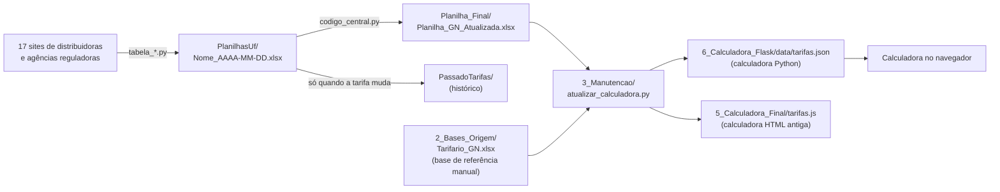

# Atualização das bases da Calculadora GLP x GN

Este guia explica:

1. como atualizar cada arquivo (no Windows e no servidor Linux AlmaLinux);
2. de onde vem cada dado e onde ele é salvo;
3. **todas as fontes de dados** que a calculadora usa para fazer os cálculos.

> Levantamento feito em 29/09/2026 a partir dos códigos e planilhas da pasta do projeto.
> Os caminhos abaixo são relativos à raiz do projeto (a pasta que contém `1_Processo_Extracao_Dados`).

---

## 1. Visão geral do fluxo



Em resumo:

| Etapa | O que faz | Resultado |
|---|---|---|
| 1. Extração | Cada `tabela_*.py` lê o site de uma distribuidora e grava uma planilha | `Fonte_Dados/PlanilhasUf/<Nome>_<data>.xlsx` |
| 2. Consolidação | `codigo_central.py` junta as 17 planilhas numa só e arquiva as tarifas novas | `Planilha_Final/Planilha_GN_Atualizada.xlsx` e `PassadoTarifas/` |
| 3. Base da calculadora | `atualizar_calculadora.py` cruza a planilha final com a base de referência `Tarifario_GN.xlsx` | `6_Calculadora_Flask/data/tarifas.json` e `5_Calculadora_Final/tarifas.js` |

A calculadora **não lê Excel**. Ela só lê o `tarifas.json` (versão Python) ou o `tarifas.js` (versão HTML).

---

## 2. Como atualizar

### 2.1 No servidor Linux (AlmaLinux) — `AtualizarDados.sh`

O `AtualizarDados.sh` faz **as três etapas** de uma vez. O servidor da calculadora percebe
o `tarifas.json` novo e passa a usá-lo sozinho, sem precisar reiniciar.

**Preparação (uma vez só, como administrador):**

```bash
sudo dnf install -y python3.11 hostname
sudo dnf install -y epel-release
sudo dnf install -y chromium chromedriver   # necessário para CE, PE, MS e MT (Selenium)
sudo timedatectl set-timezone America/Sao_Paulo   # as datas dos arquivos usam o horário do servidor

cd /opt/calculadora-gn/1_Processo_Extracao_Dados/Comece_aqui
chmod +x AtualizarDados.sh
```

Na primeira execução, o script cria o ambiente Python (`Comece_aqui/.venv`) e instala as
bibliotecas de `Fonte_Dados/requirements.txt`. A pasta `AmbientePython` (Python portátil)
é só para Windows e não é usada no Linux.

**Executar:**

```bash
./AtualizarDados.sh                                  # pergunta o nome do responsável
NOME_RESPONSAVEL="Maria Silva" ./AtualizarDados.sh   # sem pergunta (bom para agendamento)
./AtualizarDados.sh --only SP,RJ                     # só algumas UFs
./AtualizarDados.sh --sem-calculadora                # só extração + planilha final
./AtualizarDados.sh --calculadora-mesmo-com-erro     # atualiza a calculadora mesmo se algum site falhar
```

| Opção | Efeito |
|---|---|
| `--only SP,RJ,...` | Roda só os extratores dessas UFs |
| `--skip-run` | Não acessa os sites; reaproveita as planilhas mais recentes de `PlanilhasUf` |
| `--timeout 900` | Tempo máximo, em segundos, de cada extrator (padrão 900) |
| `--output caminho.xlsx` | Grava a planilha final em outro lugar |
| `--sem-calculadora` | Não executa a etapa 3 |
| `--calculadora-mesmo-com-erro` | Executa a etapa 3 mesmo se algum extrator falhar |

**Regra de segurança da etapa 3:** se algum extrator falhar, a base da calculadora **não**
é atualizada. Assim, uma falha de site não entra silenciosamente na calculadora. Confira o
log e, se estiver tudo certo, rode de novo com `--calculadora-mesmo-com-erro`.

Quando um extrator falha, a planilha final ainda é gerada: o `codigo_central.py` usa a última
planilha daquela UF que já existia em `PlanilhasUf`.

**Agendar (opcional), por exemplo toda segunda-feira às 6h**, com `crontab -e` do usuário do serviço:

```cron
0 6 * * 1  NOME_RESPONSAVEL="Agendamento" /opt/calculadora-gn/1_Processo_Extracao_Dados/Comece_aqui/AtualizarDados.sh >/dev/null 2>&1
```

O resultado de cada execução fica no log de `Execucoes_CMD/`.

### 2.2 No Windows — `AtualizarDados.bat` (fluxo original)

1. Feche a `Planilha_GN_Atualizada.xlsx` se estiver aberta no Excel.
2. Dê dois cliques em `AtualizarDados.bat` e informe o nome do responsável (ou tecle Enter).
3. Ao final, rode `5_Calculadora_Final/Atualizar_Calculadora.bat` para levar as tarifas à calculadora.
   No Windows essa etapa é **separada**.

### 2.3 Logs e auditoria

- Cada execução gera `Execucoes_CMD/Execucao_NNN_AAAA-MM-DD_<responsavel>.log`. NNN é o número da execução no dia.
- O log registra o responsável, o usuário do sistema, o computador, o início, o fim, a saída de cada extrator e o status final.
- A aba **Aviso** da planilha final mostra quem atualizou, em qual computador e quando.
- A aba **controle** registra, para cada extrator, o status e o arquivo usado.
- **Status 0** = tudo certo. **Status 1** = algum extrator falhou; a planilha foi gerada com dados antigos daquela UF.

---

## 3. Arquivo por arquivo: como atualizar, fonte e destino

| Arquivo | Como atualizar | Fonte dos dados | Onde salva |
|---|---|---|---|
| `Fonte_Dados/tabela_<distribuidora>.py` (17 scripts) | Automático, pelo `AtualizarDados.sh` / `.bat` | Site da distribuidora ou da agência reguladora (ver **seção 4**) | `Fonte_Dados/PlanilhasUf/<Nome>_AAAA-MM-DD.xlsx` |
| `Planilha_Final/Planilha_GN_Atualizada.xlsx` | Automático (`codigo_central.py`) | As planilhas mais recentes de `PlanilhasUf` | Sobrescreve sempre o mesmo arquivo. Abas: Aviso, uma por UF, controle. Abas protegidas contra edição |
| `PassadoTarifas/<Nome>_AAAA-MM-DD.xlsx` | Automático, **só quando a tarifa muda** (comparação por assinatura SHA-256 dos dados) | Planilha da UF recém-extraída | `PassadoTarifas/` + registro em `PassadoTarifas/controle_historico_tarifas.json` |
| `Execucoes_CMD/*.log` | Automático, a cada execução | Saída do processo | `Execucoes_CMD/` |
| `2_Bases_Origem/Tarifario_GN.xlsx` | **Manual, no Excel.** Salve sempre pelo Excel: as colunas ICMS, Ordem e Faixa Mín são fórmulas, e o processo lê o valor calculado salvo no arquivo | Equipe de Inteligência de Mercado; área Tributária (impostos); resoluções das agências (faixas, cascata) | O próprio arquivo |
| `3_Manutencao/atualizar_calculadora.py` | Automático no Linux (etapa 3 do `.sh`); no Windows, `Atualizar_Calculadora.bat` | `Planilha_GN_Atualizada.xlsx` + `Tarifario_GN.xlsx` | `6_Calculadora_Flask/data/tarifas.json` e `5_Calculadora_Final/tarifas.js` |
| `6_Calculadora_Flask/data/tarifas.json` | Gerado pela etapa 3. **Não edite à mão** | Idem | Lido pela calculadora Python. Recarrega sozinho quando muda. Se estiver inválido, a calculadora mostra uma página de erro em vez de calcular |
| `4_Mapa_GN/Arquivos do Mapa Brasil/Dados/municipios-gn.js` | **Manual.** Gerado a partir da planilha interna `Municipios_GN_tabular.xlsx`, que não está na pasta do projeto | Levantamento interno de municípios atendidos, em expansão e não atendidos | O próprio arquivo (5.570 municípios; atualizado em 26/03/2026) |
| `4_Mapa_GN/.../mapa-geometrias.js`, `mapa-estados.js`, `mapa-lookup.js`, `mapa-hit.png` | Raramente; só se a malha municipal mudar | Malha municipal do **IBGE** (códigos de 7 dígitos) | Pasta `Dados` do mapa |
| Constantes do cálculo (seção 6) | Manual, no código | Ver seção 6 | `6_Calculadora_Flask/calculadora/calculo.py` (e `5_Calculadora_Final/app.js`) |

### O que a automação atualiza e o que é manual

Na base da calculadora, **só a tarifa (R$/m³) e o termo fixo (R$) vêm da extração automática**.
Todos os outros campos vêm da base manual `Tarifario_GN.xlsx`:

- segmento Copa, concessionária, segmento, classe e ordem;
- faixas de consumo (mínima e máxima);
- data da deliberação (`dt_delib`);
- alíquotas de PIS/Cofins e ICMS;
- se a tarifa é em cascata;
- como o preço é publicado (com ou sem impostos);
- link da fonte.

Como é feito o cruzamento (`atualizar_calculadora.py`):

- Cada linha de `Tarifario_GN.xlsx` procura a linha extraída mais parecida, pontuando por UF, segmento Copa, segmento, concessionária e faixas.
- Com **pontuação ≥ 9**, a tarifa e o termo fixo são substituídos pelos extraídos.
- Abaixo disso, a linha **mantém o valor da base manual**.
- O script informa quantas linhas foram atualizadas e quantas foram mantidas.

Consequência: se uma distribuidora mudar faixas, segmentos ou impostos, é preciso ajustar o `Tarifario_GN.xlsx` à mão.

---

## 4. Fontes das tarifas (17 extratores, 20 concessionárias)

Todos os extratores gravam `<Nome>_AAAA-MM-DD.xlsx` com uma aba de dados e, em quase todos, uma
aba `controle` que registra o link do PDF ou da página usada e a data da extração.

| UF | Concessionária | Fonte oficial (URL) | Quem publica | Como é lido | O que é extraído |
|---|---|---|---|---|---|
| AL | Algás | https://www.arsal.al.gov.br/tarifas-mercado-cativo1/category/362-estrutura-tarifaria | ARSAL (reguladora) | Página → PDF "Estrutura Tarifária – Gás Canalizado" mais recente → pdfplumber | Tarifa sem tributos por faixa: Residencial, Comercial, Industrial, Cogeração/Climatização. Faixas em m³/dia viram m³/mês (×30) |
| AM | Cigás | https://www.cigas.com.br/tabela-tarifaria | Distribuidora | Página → PDFs TUSD e TOM → pdfplumber. Se não achar os links, usa **2 PDFs fixos no código** | TUSD sem tributos por segmento e faixa (Industrial e Matéria-Prima ×30); tarifa TOM |
| BA | Bahiagás | https://www.bahiagas.com.br/tabelatarifaria/tabelacompleta_json.txt | Distribuidora | Arquivo JSON | Faixas, tarifa sem e com tributos, vigência, contrato |
| CE | Cegás | https://www.cegas.com.br/gas-natural/tabela-de-tarifas-atual-3/ | Distribuidora | **Navegador headless (Selenium/Chrome)** | Todas as tabelas da página, sem tratamento |
| ES | ES Gás | https://arsp.es.gov.br/gas/tarifas/ESGas/tarifavigente | ARSP (reguladora) | Página → PDF da Resolução/Decisão ARSP mais recente → Anexo I | 7 segmentos: faixa m³/mês, termo fixo (R$), tarifa variável sem tributos |
| MG | Gasmig | https://gasmig.com.br/residencial/ · /comercial/ · /industrial/ | Distribuidora | Tabelas HTML (posição fixa na página) | Residencial individual e coletivo, Comercial, Industrial e Industrial-Revenda |
| MS | MSGás | https://msgas.com.br/ | Distribuidora (portaria no Diário Oficial) | Página inicial → PDF da portaria de tarifas → Anexos I, II, III e IX. Se o site bloquear, usa Selenium | Faixa, tarifa sem e com impostos. Anexos I, III e IX de m³/dia ×30 |
| MT | MTGás | https://mtgas.com.br/tarifas/ | Distribuidora | Página → PDF "tarifa vigente" → 1ª tabela. Selenium se bloquear | Residencial, Comercial/Industrial, Industrial Fertilizantes: parcelas e total sem e com impostos |
| PB | PBGás | https://pbgas.com.br/tarifas/ | Distribuidora | Tabelas HTML | Residencial, Comercial, Industrial, Cerâmico/Mineração, Poder Público, Calçadista |
| PE | Copergás | https://copergas.com.br/informacoes/tarifas/ | Distribuidora | Tabelas HTML. Selenium se o site bloquear | Todas as tabelas vigentes, com títulos e vigência |
| PR | Compagás | https://www.compagas.com.br/portal-de-tarifas/ | Distribuidora | Portal → PDF da resolução mais recente do ano mais novo → pypdf/pdfplumber | Tabelas 1.x (cativo) e 2.x (livre): TUSD fixa, TUSD variável, preço do gás, conta gráfica, tarifa. Faixas em m³/dia (convertidas ×30 na consolidação) |
| RJ | Naturgy CEG (Capital e Região Metropolitana) e CEG Rio (Interior) | https://www.naturgy.com.br/atendimento/tarifas/tarifa_rio_de_janeiro/ | Distribuidora | Página → PDFs "Tarifas da CEG" e "Tarifas da CEG RIO" → PyMuPDF | Residencial, Comercial, Industrial: faixa e tarifa |
| RN | Potigás | https://potigas.com.br/sistema-tarifario/vigente | Distribuidora | Tabelas HTML (posição fixa) | Industrial, Comercial, Residencial |
| RS | Sulgás | https://www.sulgas.com.vc/residencial/ · /comercial/ · /industrial/ | Distribuidora | Tabelas HTML | Faixa, tarifa fixa e variável. Faixas "/dia" ×30 |
| SC | SCGás | https://www.scgas.com.br/scgas/site/a-scgas/publicacoes-das-tarifas | Distribuidora | Página → PDF publicado no **DOESC 31/12/2025** (texto fixo no código) → pdfplumber | Residencial, Comercial, Industrial TG1: parcelas, tributos e tarifa bruta |
| SE | Sergipe Gás | https://www.sergipegas.com.br/tarifas | Distribuidora | Tabelas HTML | Residencial, Comercial, Industrial: tarifa sem e com impostos. Industrial publicado **por semana** |
| SP | Comgás | https://www.comgas.com.br/sobre-sua-conta/tarifas | Distribuidora (deliberação ARSESP) | Página → PDF da deliberação mais recente → PyMuPDF | Res. medição coletiva, Comercial, Industrial e Interruptível, Residencial: faixa m³/mês, termo fixo, tarifa |
| SP | Naturgy SP | https://www.naturgy.com.br/atendimento/tarifas/tarifa_sao_paulo | Distribuidora (deliberação ARSESP) | Página → PDF "vigentes na íntegra" → PyMuPDF. Se o PDF for imagem e for a **Deliberação 1806/2026**, usa uma tabela digitada no código | Residencial, Res. medição coletiva, Comercial, Industrial |
| SP | Necta | https://www.arsesp.sp.gov.br/Paginas/Tarifas.aspx#gascanalizado | ARSESP (reguladora) | Percorre as deliberações ARSESP da mais nova para a mais antiga até achar a da Necta → PyMuPDF | Residencial, Res. medição coletiva, Comercial, Industrial/Interruptível |

**UFs sem gás natural canalizado na base** (aba `uf sem GN` do `Tarifario_GN.xlsx`):
AC, AP, DF, GO, MA, PA, PI, RO, RR, TO.

---

## 5. Base de referência `2_Bases_Origem/Tarifario_GN.xlsx`

É a base **manual**. Define a estrutura que a calculadora usa. Aba principal: `Tarifario`,
com 459 linhas, 17 UFs e 20 concessionárias.

| Coluna | Uso na calculadora |
|---|---|
| Segmento Copa | Filtro "Segmento": CONDOMINIOS (67 linhas), COMERCIAL E SERVIÇOS (129), INDUSTRIAL (190), REVENDA (73) |
| Concessionaria / Concessionária | Rótulo e código da distribuidora (filtro "Concessionária") |
| UF | Filtro "Estado" |
| Segmento | Segmento tarifário da distribuidora |
| Faixa Mín (m3) / Faixa Máx (m3) | Faixas de consumo mensal. "Acima de" = 99.999.999.999 |
| Tarifa (R$/m³) / Termo Fixo (R$) | **Atualizados pela extração** (ver seção 3) |
| Preço da Concessionaria é: | Indica os impostos já embutidos no preço publicado: "sem impostos" (327 linhas), "com pis/cofins/icms" (RJ, SC e parte do RS) ou "com pis/cofins e sem icms" (as 3 de SP). A calculadora remove esses impostos para chegar ao preço líquido |
| PIS/Cofins | 9,25% em todas as UFs, exceto SP: Comgás 8,9%, Naturgy 9%, Necta 9,24% |
| ICMS | Fórmula que busca a alíquota na aba `ICMS` (ver tabela abaixo) |
| Tarifa em cascata? | "Sim" (247 linhas): o volume é distribuído pelas faixas, sem termo fixo. "Não" (212): o volume inteiro usa uma faixa, com termo fixo |
| dt_delib | Data da deliberação tarifária (**não é atualizada automaticamente**) |
| Fonte | Link oficial da tarifa |
| Ordem / Classe | Ordenação das faixas |

**ICMS por UF** (aba `ICMS`):

| Alíquota | UFs |
|---|---|
| 12% | BA, ES, PR, RJ, RS |
| 15% | SP |
| 17% | MS, MT, SC |
| 18% | MG |
| 20% | AL, AM, CE, PB, RN, SE |
| 20,5% | PE |

Outras abas de apoio:

- `Calculo impostos`: exemplo de cálculo "por dentro".
- `Observações`: por exemplo, a faixa de condomínio da Naturgy SP é estimada, e os dados semanais da PB são multiplicados por 4,345.
- `conversa_com_o_tributario`: premissas da área Tributária. A indústria credita R$ 1,47/kg de GLP; o crédito de PIS/Cofins é de 9,25% no Lucro Real; o PIS/Cofins acaba em 01/01/2027; a redução gradual do ICMS começa em 2029.
- `Cliente_teste_metrica`: exemplo de cliente de teste.

---

## 6. Parâmetros fixos do cálculo

Ficam no código (`6_Calculadora_Flask/calculadora/calculo.py`, igual a `5_Calculadora_Final/app.js`):

| Parâmetro | Valor | Uso | Fonte documentada |
|---|---|---|---|
| Fator GLP → GN | 1,210526 | 1 kg de GLP equivale a 1,210526 m³ de GN (poder calorífico) | Premissa exibida na tela ("Premissas"). **Sem referência técnica citada** |
| Fator GN → GLP | 0,826087 | 1 m³ de GN = 0,826087 kg de GLP (é 1 ÷ 1,210526) | Idem |
| Alíquota monofásica do GLP | R$ 1,6377/kg | Somada à tarifa líquida do GLP para obter a bruta | **Nenhuma fonte registrada no projeto.** A versão antiga usava R$ 1,47/kg, valor que aparece na aba `conversa_com_o_tributario`. Recomenda-se registrar a origem do novo valor |

**Como os impostos são calculados** ("por dentro", sobre o valor líquido):

1. **Tarifa líquida** = tarifa publicada × (1 − impostos já embutidos no preço publicado).
2. **Com PIS/Cofins** = líquido ÷ (1 − PIS/Cofins).
3. **Bruto** = valor com PIS/Cofins ÷ (1 − ICMS).

O painel "Empresas que podem se creditar dos impostos" só aparece para o segmento **INDUSTRIAL**.

---

## 7. Mapa de GN (`4_Mapa_GN`)

| Item | Fonte |
|---|---|
| Status de cada município (Atendido 490, Em expansão 89, Não atendido 4.991) e concessionária | Planilha interna `Municipios_GN_tabular.xlsx` (não está no projeto), convertida em `municipios-gn.js` em 26/03/2026 |
| Contornos de municípios e estados | Malha do IBGE |
| `Mapa Rede Comgas.html` | Online: mapa-base Esri World Street Map e camada `rede_comgas` do GeoSampa (Prefeitura de São Paulo) |
| `mapaconcessionarias.html` | Links para os mapas oficiais de rede de 20 distribuidoras |

O processo documentado em `3_Manutencao/README_mapa.md` (script do Power Automate) **não gera
o arquivo atual**: o arquivo tem mais campos e o status "Em expansão", que o script não produz.
A forma real de atualizar o mapa precisa ser confirmada com quem o gerou.

---

## 8. Pontos de atenção conhecidos

Encontrados durante o levantamento. **Não foram corrigidos**, para não mudar o resultado atual da extração.

**Situação dos dados hoje**

- A última extração oficial (15/09/2026) teve erro 504 nos sites da Naturgy SP e RJ. Essas UFs usaram as planilhas de 03/09/2026.
- A base da calculadora é de 03/09/2026: a etapa 3 não foi rodada depois da extração de 15/09.
- **Teste em AlmaLinux 9 (29/09/2026)**: 15 dos 17 extratores funcionaram, inclusive os que usam navegador. As duas falhas também acontecem no Windows, porque vêm de mudanças nos sites:
  - **SP** (`tabela_sp.py`): erro `decimal.InvalidOperation` ao ler uma faixa de consumo. O PDF publicado mudou de formato.
  - **MT** (`tabela_mtgas.py`): a página não tem mais um PDF com "tarifa vigente" no nome. Hoje publica "Publicação Reajuste 02-2026" (setembro/2026), o que indica **um reajuste ainda não refletido na calculadora**.

  Os dois extratores precisam de manutenção. Enquanto isso, as UFs afetadas usam a última planilha que funcionou.

**Dependem de texto ou posição fixa no código** (podem quebrar quando o site mudar)

- SCGás: procura o PDF pelo texto "DOESC 31/12/2025". Precisa ser atualizado a cada nova publicação.
- Cigás: usa PDFs de reserva com link fixo.
- Gasmig e Potigás: pegam as tabelas pela posição na página.
- RJ: separa os segmentos pela posição das linhas no PDF.
- Naturgy SP: tabela digitada da Deliberação 1806/2026, usada se o PDF vier como imagem.

**Possíveis erros de leitura** (valem também no Windows)

- MSGás: textos de filtro com acentuação corrompida no código. Linhas de outras matérias do Diário Oficial podem entrar no Anexo IX.
- Sulgás: a conversão de faixas "/dia" remove os separadores decimais. Só está correta para faixas inteiras.
- Sergipe Gás: a faixa industrial é semanal e não é convertida para mês.
- Cegás: salva as tabelas sem cabeçalho e sem aba `controle`.

**Base de referência e mapa**

- `dt_delib` é manual e não acompanha as novas tarifas. Há 6 linhas do CE com a data digitada como `001/07/2026`.
- O mapa marca municípios atendidos em PA, AP, MA e DF, mas essas UFs não têm tarifa na base.

**Rede do servidor Linux**

- Quase todos os extratores ignoram as variáveis de proxy (`trust_env = False`). Se o servidor só sair para a internet por proxy, os extratores vão falhar e será preciso ajustar o código.
- Cegás, Copergás, MSGás e MTGás usam navegador headless. No Linux o Edge é ignorado e o Chrome/Chromium é usado com `--no-sandbox` e `--disable-dev-shm-usage`. O caminho do navegador pode ser forçado com a variável `GN_CHROME_BINARY`.

---

## 9. Se der erro

1. Abra o log mais recente em `Execucoes_CMD/`. A seção "SAIDA DO CODIGO" mostra o status de cada UF.
2. `erro ao executar` num extrator geralmente indica que o site está fora do ar ou mudou de layout. Tente de novo mais tarde, só nessa UF: `./AtualizarDados.sh --only SP`.
3. `AVISO: Chrome/Chromium nao encontrado`: instale o Chromium (seção 2.1).
4. `Base tarifária indisponível` na calculadora: o `tarifas.json` gerado falhou na validação. A página lista os registros com problema. Corrija o `Tarifario_GN.xlsx` e rode a etapa 3 de novo.
